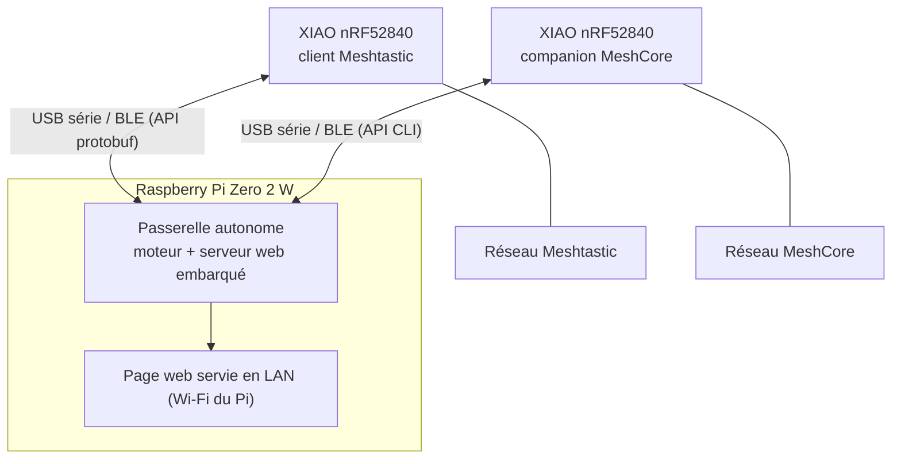
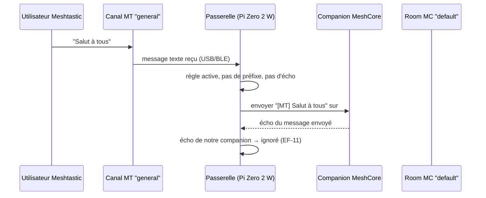

# Cahier des charges — Passerelle autonome Meshtastic ⇄ MeshCore

**Projet logiciel indépendant**, à développer de zéro.

## 1. Contexte et principe

L'objectif est une **application autonome** (passerelle) qui interconnecte deux réseaux mesh LoRa :

- un **client Meshtastic**, joignable en **USB série** ou **Bluetooth LE** ;
- un **companion MeshCore**, joignable en **USB série** ou **Bluetooth**.

Pas de Wi-Fi ni de MQTT : les deux modules sont des cartes à base de **nRF52840** type **Seeed XIAO nRF52840 + WIO-SX1262** (supportées à la fois par le firmware Meshtastic et par le firmware companion MeshCore). Le nRF52840 expose le BLE nativement, et l'USB sert à la fois à la liaison série et à l'alimentation.

### Architecture

Le Pi Zero 2 W héberge la passerelle **et** sert sa page web en Wi-Fi (hotspot ou réseau local) — les radios, elles, dialoguent uniquement par USB ou Bluetooth.

### Matériel cible

| Élément | Choix de référence |
| --- | --- |
| Machine passerelle | Raspberry Pi Zero 2 W (512 Mo RAM, Wi-Fi intégré pour l'UI web) |
| Client Meshtastic | XIAO nRF52840 + WIO-SX1262 (ou T-Beam / RAK4631 en alternative) |
| Companion MeshCore | XIAO nRF52840 + WIO-SX1262 avec firmware companion |
| Liaisons Pi ⇄ modules | 2 × USB (recommandé, alimente aussi les cartes) ou BLE en secours |

**Recommandation USB en priorité** : plus stable que BLE sur Pi Zero (le Wi-Fi et le Bluetooth partagent la même antenne, ce qui peut dégrader les deux en charge), plus simple à déboguer, et alimentation des XIAO garantie par les ports du Pi. Le BLE est implémenté pour la flexibilité (module distant sur batterie, par exemple).

## 2. Exigences de connexion

- **EC-01** : Connexion au client Meshtastic : **USB série** (port auto-détecté `/dev/ttyACM*`/`/dev/ttyUSB*`, VID/PID du nRF52840 reconnu) ou **Bluetooth LE**. Une seule interface active à la fois, basculable sans redémarrage.
- **EC-02** : Connexion au companion MeshCore : **USB série** ou **Bluetooth**. L'interface CLI du companion (échange ligne par ligne, y compris sur le port série du firmware) est la méthode de référence.
- **EC-03** : **Auto-détection à l'insertion** : quand une carte est branchée en USB, la passerelle l'interroge (question Meshtastic puis question MeshCore, avec délai d'attente de ~8 s après le redémarrage du module) pour déterminer son type — un companion MeshCore ne doit jamais être pris pour un module Meshtastic.
- **EC-04** : **Reconnexion automatique** en cas de débranchement ou de perte de liaison BLE (backoff exponentiel), avec état affiché dans l'UI et reprise du relais sans intervention.
- **EC-05** : Les deux modules peuvent être remplacés (nouveau matériel) : l'UI permet de changer d'interface sans toucher aux règles.
- **EC-06** : **Légèreté Pi Zero 2 W** : la passerelle doit tourner confortablement sur 512 Mo de RAM — pas de base lourde ni de conteneur : SQLite (ou JSON), serveur web léger (ex. Flask/FastAPI + uWSGI léger ou intégré), consommation CPU quasi nulle au repos.

## 3. Exigences fonctionnelles

### 3.1 Découverte des canaux

- **EF-01** : Au démarrage et sur demande, la passerelle **lit les canaux du client Meshtastic** (jusqu'à 8 canaux : nom, index, PSI) via l'API Meshtastic.
- **EF-02** : Elle **lit les canaux/rooms du companion MeshCore** via son API (canal par défaut, rooms AES, etc.).
- **EF-03** : Les deux listes sont affichées dans la page web avec un bouton « Rescanner ». Chaque canal a un nom affiché et un identifiant technique stable : index + PSI côté Meshtastic, identifiant de room côté MeshCore. La page montre le nom du moment. L'identifiant technique est la clé de liaison.

### 3.2 Règles de liaison

- **EF-04** : L'utilisateur crée des règles canal ⇄ canal, chacune avec un sens : **bidirectionnel** `MT ⇄ MC`, ou simple sens `MT → MC` / `MC → MT`. La règle mémorise l'identifiant technique des deux canaux, pas leur nom. Un renommage met à jour l'affichage sans casser la liaison. Un changement d'ordre des canaux ne la fait pas pointer ailleurs. Si l'identifiant disparaît au rescan, la règle reste, s'affiche comme orpheline, ne relaye rien, et ne se rattache pas à un autre canal du même nom.
- **EF-05** : Mapping N↔N autorisé ; chaque règle est activable/suspendable individuellement. Si plusieurs règles actives enverraient le même message vers la **même destination**, une seule émission a lieu. Des destinations différentes produisent une émission chacune. Seule une émission réelle compte dans le quota de son type (EF-15). L'émission évitée est journalisée avec le motif « destination déjà servie » et ne compte pas.
- **EF-06** : Une règle précise la **taille max** acceptée côté destination. La longueur min/max du filtre (EF-14) se mesure sur le texte d'origine, avant le préfixe. La troncature se fait ensuite sur la ligne complète, préfixe compris, sans couper un caractère au milieu.

### 3.3 Préfixes

- **EF-07** : Tout message relayé MT → MC reçoit le préfixe **`[MT]`** (option `[MT|CallSign]` avec le nom court de l'expéditeur lu dans le message d'origine).
- **EF-08** : Tout message relayé MC → MT reçoit le préfixe **`[MC]`**.
- **EF-09** : Préfixes personnalisables dans les réglages. Les valeurs par défaut restent `[MT]` et `[MC]`. La forme avec expéditeur, `[MT|CallSign]`, commence toujours par le marqueur `[MT`.

### 3.4 Anti-bouclage et anti-écho

- **EF-10** : Tout message dont le texte commence par un préfixe **configuré** ou par un préfixe **canonique** `[MT]` ou `[MC]` est **ignoré et jamais retransmis**, quel que soit son canal ou son sens d'arrivée. Les marqueurs `[MT]` et `[MC]` restent bloquants même si l'utilisateur les a remplacés dans les réglages : ils couvrent nos propres émissions et celles d'une autre passerelle qui utilise encore les préfixes d'origine. `[MT|CallSign]` est couvert par le marqueur `[MT`.
- **EF-11** : **Anti-écho de nos propres émissions** : tout message dont l'expéditeur est notre propre client Meshtastic ou notre propre companion est ignoré en entrée — sinon chaque message envoyé revient par le module (les nœuds republient leur trafic sur le lien série/BLE) et repartirait dans l'autre sens, doublant tout le trafic. Le préfixe reste la seconde barrière.
- **EF-12** : Cache anti-doublon (TTL réglable ~10 min) contre les retransmissions LoRa et boucles résiduelles. La clé est l'identifiant technique de l'expéditeur, le canal, et le texte une fois les espaces superflus retirés. Deux textes identiques de deux personnes différentes passent tous les deux. Le texte relayé garde sa casse.
- **EF-13** : Chaque message ignoré est tracé avec son motif (préfixe / écho de notre module / doublon).

### 3.5 Limitation du trafic et filtrage

- **EF-14** : **Filtres par règle**, sur l'identifiant technique de l'expéditeur. Le nom affiché n'est qu'un libellé. Si la liste d'autorisés n'est pas vide, seuls ces identifiants passent. La liste de bloqués de la règle en retire d'autres. La liste noire globale (EF-17) gagne toujours. Mot-clé requis ou exclu (ex. ignorer les commandes `!pos`) et longueur min/max ne s'appliquent qu'au texte écrit par une personne, pas à une position ni à une mesure.
- **EF-15** : **Anti-flood** : deux quotas par règle, discussion d'un côté, positions et mesures de l'autre, plus un plafond global de l'instance. Chaque quota a sa file courte et abandonne ses plus anciens, sans rattrapage en rafale. Heures silencieuses par règle pour la discussion et les mesures. Une détection passe pendant ces heures, avec au plus une émission par minute et par personne.
- **EF-16** : **Coalescence (option par règle, décochée par défaut)** : messages de discussion reçus dans une fenêtre réglable (10/30/60 s, défaut 30 s) regroupés en **une seule émission**, un seul préfixe, dans l'ordre d'arrivée : `[MT] Nom1 : a / Nom2 : b`. Émission anticipée dès que le bloc atteint la taille max du réseau de destination. Un message déjà trop long pour cette taille part seul et n'est pas regroupé.
- **EF-17** : **Liste noire globale d'utilisateurs** : interdit le transfert des messages, positions et mesures de certains utilisateurs sur toutes les règles. La comparaison se fait sur l'identifiant technique (ID Meshtastic, ou clé MeshCore), pas sur le nom affiché. Chaque entrée vise **une identité sur un seul réseau**. Pour bloquer la même personne des deux côtés, on ajoute une seconde entrée avec son autre nom ; les deux lignes sont indépendantes. Saisie assistée depuis les nœuds connus du réseau concerné, motif et date conservés. Aucun rapprochement automatique entre les deux réseaux. L'utilisateur blacklisté **continue de recevoir** les messages de son propre réseau.
- **EF-18** : **Journal de rejet motivé** : motif par message non relayé (préfixe / écho / doublon / quota / filtre / liste noire / heure silencieuse / message direct / destination déjà servie / position inchangée / position aberrante / mesure inchangée), compté par motif dans les statistiques. Le motif retenu est celui du premier filtre qui a arrêté le message (EF-23).

### 3.6 Comportement attendu

### 3.7 Positions et mesures

Options par règle, **arrêtées par défaut**. Elles suivent le sens et les canaux de la règle. La liste noire s'applique. La passerelle ne va pas interroger le réseau : elle ne retransmet que ce qui est déjà arrivé. Ces envois ne sont pas mélangés à la coalescence du texte (EF-16). Chaque émission réelle compte dans le quota positions et mesures (EF-15).

- **EF-19** : **Positions dans les deux sens**, si l'option de la règle est active. Vers Meshtastic, chaque personne devient un repère à son nom, mis à jour sur place. Vers MeshCore, une ligne courte sur le canal lié : `[MT|Nom] pos 48.856,2.352` (et `[MC|Nom]` dans l'autre sens). La position n'est jamais écrite dans le GPS ni dans l'annonce du module de la passerelle.
- **EF-20** : **Filtre de position.** Une position identique après arrondi à 4 décimales ne repart pas (motif « position inchangée »). L'altitude ne compte pas dans la comparaison. Une coordonnée vide ou `0,0`, ou un saut à plus de 200 km/h entre deux points, est jeté (motif « position aberrante »). Même en déplacement, au plus une émission toutes les 5 minutes. Après une heure sans mouvement, une seule reprise, pour distinguer un nœud immobile d'un nœud disparu.
- **EF-21** : **Mesures**, si l'option de la règle est active. Température, humidité, pression et batterie ne repartent que si l'écart dépasse un seuil : 0,5 °C, 2 points d'humidité, 1 hPa, 5 % de batterie. Les valeurs qui ont bougé pour la même personne partent en une seule ligne. Une détection ou une sonnette part à chaque déclenchement, avec au plus une émission par minute et par personne. Le rappel du même état est filtré comme une mesure inchangée (motif « mesure inchangée »).
- **EF-22** : Une ligne ou un repère produit par la passerelle n'est **jamais relu** comme une nouvelle position ou une nouvelle mesure. Les positions et mesures de nos propres modules sont ignorées (EF-11).

### 3.8 Ordre de filtrage

- **EF-23** : Chaque message, position ou mesure traverse **un seul passage**. On s'arrête au premier motif et on le journalise. L'ordre est : message direct ; écho de notre module ; préfixe `[MT]`, `[MC]` ou préfixe réglé ; liste noire ; filtres de la règle (expéditeur, mot-clé, longueur) ; heures silencieuses ; position identique, trop rapprochée ou aberrante, ou mesure sous le seuil, ou même état rappelé ; doublon déjà vu ; destination déjà servie ; quota ; file d'attente.

## 4. Exigences techniques

- **ET-01** : Pile logicielle suggérée : **Python 3** avec `meshtastic` (API protobuf, USB et BLE natifs) et un client MeshCore sur le lien série (échange ligne par ligne avec le companion). Tout autre stack acceptable si les deux API sont couvertes.
- **ET-02** : La passerelle est un **service systemd** : démarrage automatique, redémarrage en cas de crash, journal système. Image SD / script d'installation fourni pour Pi Zero 2 W (Raspberry Pi OS Lite 64 bits).
- **ET-03** : Configuration persistante. Plusieurs fichiers nommés coexistent, par exemple `normal.conf` et `crise.conf`. Chaque fichier est l'image complète d'une passerelle : les deux modules (interface USB ou Bluetooth, identifiants), les canaux connus, les règles et leurs filtres, la liste noire, les préfixes, les quotas et les options de positions et de mesures. Charger un fichier restaure tous ces éléments. Le mot de passe admin n'est pas dans le fichier. Une seule configuration est active. L'enregistrement, le chargement et la suppression se font depuis la page web. Au redémarrage, la configuration active est rechargée.
- **ET-04** : **Serveur web embarqué** léger (port configurable, ex. 8080) : page de gestion servie par le passerelle, mise à jour temps réel par WebSocket. **Authentification par mot de passe obligatoire** (session) ; accès LAN/hotspot du Pi uniquement.
- **ET-05** : Journal local : tous les messages reçus, relayés et ignorés (horodatage, canal, expéditeur, motif), consultable dans l'UI avec filtres ; rétention bornée (ex. 7 jours) pour préserver la carte SD.
- **ET-06** : Périmètre phase 1 : **texte de canal ou de room**, plus positions et mesures **en option par règle, arrêtées par défaut** (EF-19 à EF-22). Pas de messages système. Un message direct, adressé à une personne plutôt qu'à un canal, est ignoré, écrit dans le journal avec le motif « message direct », et **jamais relayé**.
- **ET-07** : Un seul couple de modules (1 client Meshtastic + 1 companion MeshCore) ; l'architecture doit rester extensible (interface générique « module ») sans l'implémenter en phase 1.
- **ET-08** : **Empreinte Pi Zero 2 W** : au repos, CPU < 5 % et RAM < 100 Mo pour la passerelle ; le relayage d'un message ne doit pas dépasser 1 s de traitement. Écritures disque minimales (journal en mémoire, flush périodique) pour préserver la carte SD.

## 5. Page web de gestion

Page unique à onglets (maquette fournie séparément) :

1. **Tableau de bord** : état des deux modules (USB/BLE, connecté/déconnecté), compteurs par sens, messages ignorés par motif, règles actives.
2. **Connexions** : choix USB ou Bluetooth pour chaque module, test de connexion, état du matériel (firmware, batterie si remontée), rescanner.
3. **Règles** : deux colonnes de canaux (MT / MC), choix du sens, tableau des règles avec interrupteurs (actif, coalescence, positions, mesures) et suppression. Positions et mesures sont arrêtées par défaut. Une règle dont le canal a disparu s'affiche orpheline.
4. **Liste noire** : une entrée par identité et par réseau. Pour bloquer la même personne des deux côtés, une seconde entrée avec son autre nom.
5. **Journal** : flux temps réel filtrable (sens, canal, motif d'ignoré).
6. **Réglages** : préfixes, TTL anti-doublon, quotas discussion et positions/mesures, taille max des messages, mot de passe admin, gestion des configurations (`normal.conf`, `crise.conf`, etc.) : charger, enregistrer sous un nom, supprimer.

## 6. Périmètre

| Inclus (phase 1) | Exclu (phase 2 et +) |
| --- | --- |
| Texte de canal ou de room ; positions et mesures en option, arrêtées par défaut | Messages directs, météo, interrogation active des capteurs |
| 1 client Meshtastic + 1 companion MeshCore (XIAO nRF52840) | Multi-modules par réseau |
| USB et Bluetooth pour chaque module | Wi-Fi/MQTT entre modules et Pi |
| Préfixes, anti-boucle, anti-écho, filtres, liste noire, coalescence optionnelle | Réconciliation d'identités entre réseaux |
| Web UI avec mot de passe (LAN/hotspot du Pi) | HTTPS, multi-utilisateurs, rôles |
| Installation Pi Zero 2 W (systemd + script d'installation) | Paquet tout-en-un sur firmware embarqué |

## 7. Critères d'acceptation

1. Les canaux des deux modules sont listés automatiquement après connexion (USB et BLE testés pour chaque module).
2. Une carte XIAO branchée en USB est reconnue Meshtastic ou MeshCore automatiquement, sans confusion possible.
3. Un message posté sur un canal MT lié apparaît préfixé `[MT]` sur le canal MC lié en moins de 5 s, et réciproquement avec `[MC]`.
4. Un message qui commence par un préfixe configuré, ou par `[MT]` ou `[MC]`, n'est **jamais** retransmis, dans les trois modes de liaison. Changer les préfixes dans les réglages ne réouvre pas le passage aux marqueurs canoniques.
5. Un message envoyé par la passerelle et revenant en écho par l'un des modules n'est **jamais** re-relayé.
6. Une règle en simple sens ne relaye que dans son sens ; une règle suspendue ne relaye rien.
7. Débrancher puis rebrancher un module (ou changer USB ⇄ BLE) : reconnexion automatique et reprise du relais sans intervention ni perte des règles.
8. Une rafale de 50 messages en 1 min sur un canal lié respecte le quota : surplus abandonné et tracé, aucun rattrapage en rafale.
9. Une entrée de liste noire empêche le relais de cette identité depuis son réseau, sans l'empêcher de recevoir. Bloquer son autre nom sur l'autre réseau demande une seconde entrée. Retirer une entrée rétablit le transfert pour cette identité seulement.
10. Une règle avec coalescence (30 s) : 3 messages reçus en 20 s produisent une seule émission `[MT] Nom1 : a / Nom2 : b`, ordre d'arrivée préservé. Un message déjà trop long pour la destination part seul.
11. Les réglages et règles survivent à un redémarrage du service.
12. **Sur Pi Zero 2 W** : au repos, CPU < 5 % et RAM < 100 Mo pour la passerelle ; l'UI web reste fluide pendant un relayage ; pas d'écriture disque continue (carte SD préservée).
13. Renommer un canal lié, ou changer son ordre, laisse la règle sur le même canal. Si ce canal disparaît au rescan, la règle reste affichée comme orpheline, ne relaye rien, et ne se rattache pas à un homonyme.
14. Un message direct reçu sur l'un ou l'autre module est journalisé avec le motif « message direct » et n'est jamais relayé, même si une règle est active sur un canal du même module.
15. Deux règles actives du même canal vers la même destination ne produisent qu'une émission. Le quota ne compte que cet envoi. Deux destinations différentes produisent deux émissions, chacune comptée. L'émission évitée est journalisée « destination déjà servie ».
16. Avec les options arrêtées, aucune position ni mesure n'est relayée. Une fois les positions actives, une position nouvelle devient un repère mis à jour sur place côté Meshtastic, et une ligne `[MT|Nom] pos …` ou `[MC|Nom] pos …` côté MeshCore. Le GPS du module de la passerelle ne change pas.
17. La même position, ou une position répétée en moins de 5 minutes, ne repart pas. Une coordonnée vide, `0,0`, ou un saut à plus de 200 km/h est jeté avec le motif « position aberrante ». L'altitude seule ne fait pas repartir une position. Après une heure sans mouvement, une seule reprise part. Deux mesures inchangées ne partent pas. Deux valeurs changées de la même personne partent en une seule ligne. Une détection part à chaque déclenchement, au plus une fois par minute et par personne, y compris en heures silencieuses. Le même état rappelé ne repart pas.
18. Une ligne de position ou un repère émis par la passerelle, relu par un module, n'est pas renvoyé vers l'autre réseau.
19. Le premier filtre qui arrête un message est le motif journalisé, dans l'ordre d'EF-23. Deux « ok » de deux personnes en moins de 10 minutes passent tous les deux. Le même « ok » de la même personne sur le même canal est un doublon.
20. Les positions et mesures ne consomment pas le quota de discussion, ni l'inverse. Chaque file abandonne ses plus anciens.
21. Avec une liste d'autorisés non vide, un expéditeur absent est filtré. Un identifiant de la liste de bloqués de la règle l'est aussi. Un identifiant de la liste noire globale l'est même s'il est autorisé par la règle. La longueur min/max se juge avant le préfixe. La troncature finale ne coupe pas un caractère au milieu.
22. Depuis la page web, enregistrer l'état courant sous `crise.conf` puis modifier règles, modules ou quotas, et recharger `normal.conf` : toute la passerelle de `normal.conf` revient (modules, canaux, règles, liste noire, préfixes, quotas). Après redémarrage, cette configuration est encore active. Le mot de passe admin ne change pas.